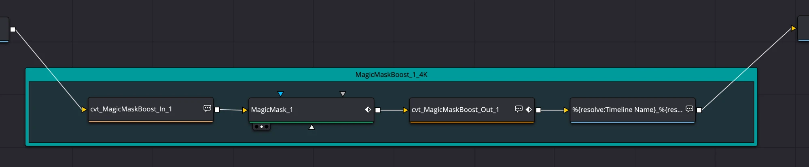

# CVT Magic Mask Boost

Fusion macros for DaVinci Resolve Studio that give Magic Mask more pixels to
work with. They crop the part of the frame you care about, scale it up, run
Magic Mask on the enlarged crop, then shrink the mask and put it back in its
original place in the full frame.

From [Creative Video Tips](https://creativevideotips.com), created by Chadwick.
Free to use and share. **Not for sale**: please don't sell these macros or
redistribute them for payment.



## Video walkthrough

Watch it on YouTube: [Resolve Magic Mask "Boost" Macro](https://youtu.be/R605dINlNYA)

[](https://youtu.be/R605dINlNYA)

## How it works

Each Setup macro drops one row of nodes inside a labelled underlay:

```
Image -> In (crop box + upscale) -> Magic Mask -> Out (downscale + place back) -> Saver
```

1. **In:** drag the crop box in the viewer around your subject. The box is
   cropped out and scaled up (Lanczos filter).
2. **Magic Mask:** works on the enlarged crop at stock Resolve settings.
3. **Out:** scales the mask back down (Linear filter), puts it back where the
   crop came from on a full-size frame, and outputs an alpha-only mask.
4. **Saver:** writes the result as an EXR sequence.

| Setup | Upscales to | Underlay |
| --- | --- | --- |
| `cvt_MagicMask_1..5_Setup_4K` | 3840 wide (UHD) | teal |
| `cvt_MagicMask_6_Setup_6K` | 6144 wide (DCI 6K) | navy, heavier on GPU memory |

The six rows are numbered so you can use several in one comp. Each Out finds
its matching In by number, so keep pairs together (In 2 with Out 2).

## Install

1. Download the zip from the latest
   [Release](https://github.com/creativevideotips/cvt-magic-mask-boost/releases/latest).
2. Copy the `cvt_MagicMask_<n>_Setup_*.setting` files into the Fusion Macros
   folder:
   - macOS: `~/Library/Application Support/Blackmagic Design/DaVinci Resolve/Fusion/Macros/`
   - Windows: `%APPDATA%\Blackmagic Design\DaVinci Resolve\Support\Fusion\Macros\`
   - Linux: `~/.local/share/DaVinciResolve/Fusion/Macros/`
3. When updating, remove the previous version's files first so the Effects
   library doesn't list both.
4. Restart DaVinci Resolve.

The files in `parts/` are the In and Out macros on their own. Every Setup
already contains them, so you don't need to install them. They're there if you
want to build your own chain, for example with a different keyer in the middle.

## Saver path setup (once)

The Saver's output path starts with the Fusion Path Map entry `Savers:`.
Create it once in **Fusion > Fusion Settings > Path Map > New**:

- From: `Savers:`
- To: your projects folder (keep the trailing slash)

Renders then land in
`<projects folder>/<Project Name>/Savers/<Timeline_Clip_Source>/`.

## Notes

- Magic Mask (and so these macros) needs DaVinci Resolve Studio.
- Nodes already in a comp keep their old settings after you update the files.
  Add a fresh Setup to get the new version.
- The version is in the file name. Version history is in
  `cvt_MagicMaskBoost_README_vX.YY.txt` and on the
  [Releases](https://github.com/creativevideotips/cvt-magic-mask-boost/releases) page.

## License

[Creative Commons Attribution-NonCommercial 4.0 International (CC BY-NC 4.0)](https://creativecommons.org/licenses/by-nc/4.0/).
You may use, share and adapt these macros with credit to Chadwick / Creative
Video Tips, but not for commercial purposes such as selling them.
